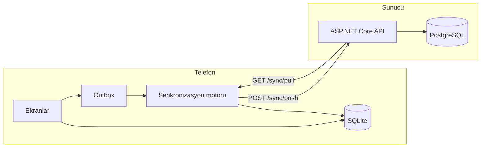

# LexiSync

[](https://github.com/hlygns/LexiSync/actions/workflows/ci.yml)

YDS için aralıklı tekrar (spaced repetition) tabanlı, **offline-first** mobil kelime uygulaması.
İnternet olmadan tam çalışır; bağlantı gelince sunucuyla kendiliğinden senkronize olur.

**Teknolojiler:** React Native (Expo) · TypeScript · SQLite (Drizzle) · ASP.NET Core (.NET 10) · EF Core · PostgreSQL · Docker · GitHub Actions

## Ekran görüntüleri

<!-- SCREENSHOTS -->

## Özellikler

- **Kayıt:** karşılama sayfası, ardından kaydırmalı kartlarla motivasyon ve günlük hedef, en sonda kullanıcı adı ve şifre. JWT ve tek kullanımlık refresh token; oturum cihazda şifreli saklanır.
- **224 hazır YDS kelimesi** (akademik fiiller, sıfatlar, isimler, bağlaçlar, phrasal verb'ler); her biri iki örnek cümle ve cümlelerin Türkçesiyle
- **20 kelimelik üniteler:** kelime kartında önce İngilizcesi, dokununca Türkçesi ve örnek cümleler
- **Ünite testi:** her ünitenin sonunda 20 soru (anlam seçme ve boşluk doldurma); %70 ile geçilmeden sonraki ünite açılmaz
- **Çalışma alanları:** Cloze Test, Çeviri (İngilizce ⇄ Türkçe cümle), Kelime Testi ve hepsinden karışık 20 soruluk Genel Test
- **Açıklamalı sonuçlar:** her yanlış ve boş bırakılan soru için doğru cevap, cümlenin Türkçesi ve diğer şıkların neden yanlış olduğu
- **Tekrar:** öğrenilen kelimeler SM-2 algoritmasıyla zamanı gelince geri gelir; "Bilmiyorum / Zor / İyi / Kolay" ile puanlanır
- **Gelişimim:** her alan için deneme sayısı, ortalama, en iyi sonuç ve son denemeler; günlük hedef ve gün serisi
- **Kendi kelimelerin:** ana sayfadaki "+" ile kendi grubuna kelime ekleme
- **Offline-first:** tamamen çevrimdışı çalışır, bağlantı gelince kendiliğinden senkronize olur; aynı hesapla telefon ve tablette çalışılabilir

## Mimari



Uygulama her zaman önce cihazdaki SQLite'a yazar. Sunucu yalnızca cihazlar arasında köprüdür;
kapalı olsa da uygulama aynı şekilde çalışır, sadece senkronizasyon gecikir.

Backend dört katmandır ve bağımlılıklar hep içe doğrudur:

| Proje | İçerik |
|---|---|
| `LexiSync.Domain` | Entity'ler ve SM-2 algoritması. Hiçbir projeye ve pakete bağımlı değil. |
| `LexiSync.Application` | Arayüzler, DTO'lar, çakışma kuralı |
| `LexiSync.Infrastructure` | EF Core, PostgreSQL, kimlik ve senkronizasyon servisleri |
| `LexiSync.Api` | Uç noktalar, JWT doğrulama |

## Senkronizasyon

1. Kullanıcı bir kart ekler ya da çalışır. Kayıt SQLite'a yazılır ve **aynı transaction içinde**
   `outbox` tablosuna bir değişiklik satırı eklenir. İkisi birlikte kaydedilir ya da hiçbiri kaydedilmez.
2. Bağlantı geldiğinde, uygulama öne geldiğinde ya da yeni bir değişiklik olduğunda **push** çalışır:
   outbox'taki değişiklikler `POST /sync/push` ile gönderilir.
3. Sunucu her değişikliği uygular, bir `ServerVersion` verir ve sonucu bildirir. Cihaz cevap aldığı
   değişiklikleri outbox'tan siler.
4. **Pull:** cihaz `GET /sync/pull?since=<son versiyon>` ile kendisinden sonra değişenleri alır,
   yerel veriye uygular ve yeni "son versiyon" değerini saklar.

### Çakışma kuralları

| Durum | Kural |
|---|---|
| İki cihaz aynı kartı ya da desteyi düzenledi | Satır bazında last-write-wins: `UpdatedAt` değeri büyük olan kazanır |
| Bir cihaz sildi, diğeri düzenledi | Silme her zaman kazanır |
| İki cihazda aynı kart çalışıldı | Çakışma yok: tekrar kayıtları (`ReviewLog`) sadece eklenir, ikisi de saklanır |
| Kartın tekrar durumu (`ReviewState`) | Senkronize edilmez; her yerde kayıtlar zaman sırasıyla SM-2'den geçirilerek yeniden hesaplanır |
| Deste silindi | İçindeki kartlar da silinir; o sırada başka cihazda eklenen kart da silinmiş olarak saklanır |
| Ünite testi sonuçları (`QuizResult`) | Tekrar kayıtları gibi sadece eklenir; bir cihazda geçilen test diğerinde de üniteyi açar |

### Idempotency

Her değişiklik cihazda üretilen bir `ChangeId` taşır. Ağ koptuğu için cihaz cevabı alamazsa aynı
değişikliği aynı `ChangeId` ile tekrar gönderir; sunucu `ProcessedChanges` tablosunda bu kimliği
görür ve değişikliği ikinci kez uygulamaz.

### Diğer kararlar

- **Kimlikler cihazda üretilir (UUID v7).** Çevrimdışı oluşturulan kaydın kimliği sunucuya gidince
  değişmez, ilişkiler bozulmaz. Sunucuda üretilen referans veri (`Exam`) ise `int` kullanır.
- **Silme, işaretlemedir (tombstone).** Satır silinmez, `DeletedAt` doldurulur. Gerçekten silinseydi
  diğer cihaz silindiğini öğrenemezdi.
- **Kullanıcı başına tek push.** Sunucu, bir kullanıcının push isteklerini PostgreSQL advisory lock
  ile sıraya koyar. Böylece versiyonlar artan sırada commit edilir ve pull hiçbir satırı atlamaz.

## SM-2

Her kart üç değer tutar: üst üste doğru sayısı, bir sonraki tekrara kalan gün ve kolaylık katsayısı
(başlangıç 2.5, alt sınır 1.3).

- Puan 3'ten küçükse kart sıfırlanır ve ertesi gün tekrar gelir.
- Puan 3 ve üzeriyse aralık ilk doğruda 1 gün, ikincide 6 gün, sonrasında `önceki aralık × katsayı` olur.
- Her tekrardan sonra katsayı güncellenir: `EF' = EF + (0.1 − (5 − q)(0.08 + (5 − q) × 0.02))`

Algoritma saf bir fonksiyondur ve iki dilde yazılmıştır: sunucuda C#
([Sm2.cs](backend/src/LexiSync.Domain/Srs/Sm2.cs)), telefonda TypeScript
([sm2.ts](mobile/src/srs/sm2.ts)). İkisi de aynı [shared/sm2-vectors.json](shared/sm2-vectors.json)
dosyasındaki 20 senaryoya karşı test edilir; iki taraf aynı sonucu vermezse CI kırılır.

## Kurulum

### Backend

Gerekenler: Docker.

```bash
cp .env.example .env        # içindeki şifreyi ve JWT_KEY değerini değiştir
docker compose up -d --build
curl http://localhost:8080/health
```

API açılışta veritabanı tablolarını kendisi oluşturur.

### Mobil

Gerekenler: Node 22 ve telefonda Expo Go.

```bash
cd mobile
npm install
cp .env.example .env        # API adresini ayarla (dosyadaki açıklamaya bak)
npx expo start
```

Terminaldeki QR kodu Expo Go ile okut. Gerçek telefonda API adresi `localhost` olamaz;
bilgisayarın yerel ağdaki IP adresi yazılmalıdır. IP değişirse adres uygulamanın içinden de
değiştirilebilir: karşılama ekranının altında ve profilde "Sunucu · Değiştir".

### Android APK

React Native için Java 17 gerekir (Java 24 ve üzeri C++ derleme adımını bozar).

```powershell
cd mobile
npx expo prebuild --platform android --clean
$env:JAVA_HOME = "<Java 17 klasörü>"
$env:ANDROID_HOME = "$env:LOCALAPPDATAAndroidSdk"
cd android
.gradlew.bat assembleRelease
# çıktı: android/app/build/outputs/apk/release/app-release.apk
```

## API

| Metot | Yol | Amaç |
|---|---|---|
| POST | `/auth/register` | Kayıt (kullanıcı adı, şifre, motivasyon, günlük hedef) |
| POST | `/auth/login` | Giriş; access ve refresh token döner |
| POST | `/auth/refresh` | Token yenileme (refresh token tek kullanımlıktır) |
| GET | `/auth/me` | Token'ın sahibi |
| GET | `/exams` | Sınav listesi |
| POST | `/sync/push` | Cihazdaki değişiklikleri gönder |
| GET | `/sync/pull?since={version}` | Bu versiyondan sonra değişenleri al |
| GET | `/health` | Sağlık kontrolü (veritabanına erişimi de dener) |

## Testler

| Paket | Sayı | Ne test eder |
|---|---|---|
| Backend unit (xUnit) | 42 | SM-2, çakışma kuralı |
| Backend entegrasyon (xUnit + Testcontainers) | 40 | Gerçek PostgreSQL üzerinde kimlik, push/pull, idempotency, çakışma, kullanıcı izolasyonu |
| Mobil unit (Jest) | 89 | SM-2, birleştirme kuralı, gün serisi, soru ve açıklama üretimi, kelime ve çeviri verisi |
| Mobil uçtan uca (Jest) | 12 | Gerçek senkronizasyon motoru, iki sanal cihaz, çalışan API |

```bash
dotnet test backend/LexiSync.slnx      # Docker çalışıyor olmalı

cd mobile
npm test
npm run test:e2e                       # önce: docker compose up -d
```

Uçtan uca testlerde her "cihaz" kendi bellek içi SQLite veritabanına sahiptir ve uygulamanın gerçek
senkronizasyon kodunu çalıştırır. Senaryolar: çevrimdışı çalışıp sonra senkronize olma, iki cihazın
aynı kartı düzenlemesi, silme ile düzenlemenin çakışması, cevabı kaybolan push'un tekrar gönderilmesi.

## Canlıya alma

Backend, `backend/Dockerfile` ile herhangi bir container servisine kurulabilir. Gereken ortam değişkenleri:

| Değişken | Değer |
|---|---|
| `ConnectionStrings__Default` | PostgreSQL bağlantı cümlesi |
| `Jwt__Key` | En az 32 karakterlik rastgele değer |
| `Database__MigrateOnStartup` | `true` |

Android APK bulutta da derlenebilir: `cd mobile && npx eas-cli build --platform android --profile preview`
(`EXPO_PUBLIC_API_URL` değeri EAS ortam değişkeni olarak verilmelidir).

## Bilinen sınırlamalar

- Çakışma satır bazındadır: iki cihaz aynı kartın farklı alanlarını değiştirirse sonraki yazan
  kazanır, diğerinin değişikliği kaybolur.
- "Sonraki yazan" cihaz saatine göre belirlenir; saati yanlış bir cihaz çakışmayı haksız kazanabilir.
- Pull sayfalama yapmaz; çok büyük hesaplarda ilk senkronizasyon tek istekte gelir.
- Çıkış yapmak cihazdaki veriyi siler; gönderilmemiş değişiklik varsa uygulama önce uyarır.
- Hazır kelimeler ve örnek cümleler YDS tarzı akademik metinlerde sık geçen kelimelerden derlendi;
  ÖSYM'nin resmî bir kelime listesi yoktur ve sorular geçmiş sınavlardan alınmamıştır.

## Yol haritası

- Yapay zekâ ile örnek cümle üretimi
- Günlük hatırlatma bildirimi
- CSV ile toplu kelime içe aktarma
- Çalışma günleri ısı haritası

## Klasör yapısı

```
backend/
  src/        Domain, Application, Infrastructure, Api
  tests/      UnitTests, IntegrationTests
  Dockerfile
mobile/
  src/app/    Ekranlar (Expo Router)
  src/db/     SQLite şeması ve sorgular
  src/sync/   Outbox, push/pull motoru
  src/srs/    SM-2 (TypeScript)
  src/quiz/   Soru ve açıklama üretimi (ünite testi, cloze, çeviri, kelime, genel test)
  src/practice/ Çeviri soruları ve çalışma alanları
  src/starter/ Hazır YDS kelimeleri ve örnek cümlelerin Türkçesi
  drizzle/    SQLite migration'ları
shared/       İki tarafın ortak SM-2 test vektörleri
docker-compose.yml
```
